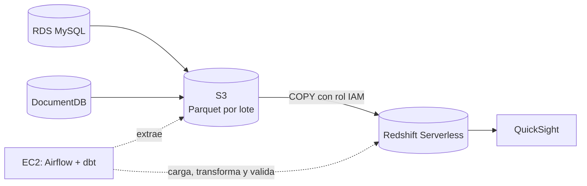

# Data warehouse de comercio electrónico en AWS

Migración a AWS del data warehouse local (DuckDB) del repositorio
[DE-DW](https://github.com/smm-0216/DE-DW/tree/main). Se conservan las reglas de
negocio, el modelo dimensional, la cuarentena y el SCD tipo 2.



Este README contiene todos los pasos para replicar el proyecto, desde el
despliegue hasta la eliminación de los recursos.

| Si buscas | Consulta |
|---|---|
| Replicar el proyecto | Este README, en orden |
| Cómo funcionan los lotes, los estados y las decisiones técnicas | [docs/aws/pipeline.md](docs/aws/pipeline.md) |
| Red, permisos, túneles, costos y pausa de los recursos | [terraform/README.md](terraform/README.md) |
| Todos los documentos | [docs/README.md](docs/README.md) |

## Contenido

1. [Requisitos](#1-requisitos)
2. [Configuración](#2-configuración)
3. [Despliegue](#3-despliegue)
4. [Acceso a la instancia y a Airflow](#4-acceso-a-la-instancia-y-a-airflow)
5. [Carga inicial](#5-carga-inicial)
6. [Escenarios de validación](#6-escenarios-de-validación)
7. [Dashboard en QuickSight](#7-dashboard-en-quicksight)
8. [Nuevo lote hasta el dashboard](#8-nuevo-lote-hasta-el-dashboard)
9. [Eliminación de los recursos](#9-eliminación-de-los-recursos)
10. [Referencia](#10-referencia)

## 1. Requisitos

En el equipo local:

- Terraform 1.5 o superior.
- AWS CLI v2 con un perfil con permisos de administrador. En los ejemplos se llama `admin`:

  ```bash
  aws sts get-caller-identity --profile admin
  ```

- `jq`, para leer la contraseña de Redshift en el paso 7.

La terminal de la instancia se abre desde la consola de AWS, así que no hace
falta instalar nada más. El Session Manager plugin solo se necesita para usar los
[túneles](terraform/README.md#acceso).

La instancia clona el repositorio por HTTPS, así que este debe ser público y la
rama que se despliega debe estar en GitHub.

## 2. Configuración

```bash
git clone https://github.com/Dduquejh/Taller-DataWarehouse-DE-20262.git
cd Taller-DataWarehouse-DE-20262/terraform
cp terraform.tfvars.example terraform.tfvars
curl -s https://checkip.amazonaws.com     # IP pública del equipo
```

Edita `terraform.tfvars`, que git ignora y no contiene secretos:

| Variable | Valor | Obligatoria |
|---|---|---|
| `aws_profile` | Perfil de AWS CLI | Sí |
| `allowed_cidrs` | Tu IP, por ejemplo `["203.0.113.10/32"]`. Es lo único que abre el puerto 8080 de Airflow | Sí, para entrar a Airflow |
| `budget_email` | Correo para las alertas de costo, al 50 %, 80 % y 100 % del presupuesto. Viene comentada en el ejemplo | Recomendada |
| `repo_url`, `repo_branch` | Repositorio y rama que clona la instancia | Solo si usas un fork u otra rama |

## 3. Despliegue

```bash
terraform init
terraform plan      # debe crear recursos y no destruir ninguno
terraform apply     # 15 a 20 minutos
terraform output -raw airflow_url
```

El plan crea 53 recursos, o 54 con `budget_email`. Guarda la URL del último
comando.

**Costo:** los recursos empiezan a cobrar desde este paso. Una sesión de 8 horas
se estima entre USD 2 y 4, sin QuickSight, y hasta unos USD 7 si Redshift llega a
su límite diario. Al terminar, sigue el [paso 9](#9-eliminación-de-los-recursos).
El detalle está en
[terraform/README.md](terraform/README.md#costo-estimado-us-east-2-on-demand-aproximado).

## 4. Acceso a la instancia y a Airflow

Al terminar el `apply`, la instancia tarda otros 5 a 10 minutos en instalar
Docker, clonar el repositorio y levantar Airflow.

1. En la consola de AWS, ve a **EC2 → Instancias → `ecommerce-dw-airflow` → Connect → Session Manager → Connect**.

2. Espera a que aparezca `== Arranque terminado` y sal con `Ctrl+C`:

   ```bash
   sudo su - ec2-user
   sudo tail -f /var/log/cloud-init-output.log
   ```

3. Abre una sesión nueva de `ec2-user`, para que cargue el comando `dwc`. Luego comprueba los servicios y obtén la contraseña de Airflow:

   ```bash
   exit
   sudo su - ec2-user
   cd /opt/ecommerce-dw
   dwc ps                                          # postgres, webserver y scheduler activos
   sudo grep AIRFLOW_ADMIN_PASSWORD .airflow-secrets
   ```

4. Abre la URL del paso 3 en el navegador, **con `http://`** (`http://<IP pública>:8080`), y entra con el usuario `airflow`. Airflow no sirve HTTPS en ese puerto.

Debe aparecer el DAG `ecommerce_pipeline`, pausado. **No lo actives a mano:** el
script del paso 5 lo activa cuando las fuentes ya tienen datos.

Los comandos de los pasos 5 a 8 se ejecutan en esta terminal, desde
`/opt/ecommerce-dw`, salvo los de Terraform y QuickSight del paso 7.

## 5. Carga inicial

```bash
scripts/generate_data.sh                 # crea tablas y colecciones y carga datos sintéticos
scripts/run_pipeline.sh --mode full      # activa y dispara el DAG, y espera el resultado
```

Al activarse el DAG, Airflow también lanza una ejecución programada, que crea su
propio lote. Es normal: las dos cargan los mismos datos y el resultado no cambia.
Tu ejecución es la que empieza por `manual__`.

Para comprobar el resultado:

```bash
scripts/warehouse.sh runs                # ejecuciones, estado y pruebas de dbt
scripts/warehouse.sh batches             # lotes, entidades y marcas de agua
scripts/warehouse.sh reconcile           # hechos frente a la fuente validada
```

**Resultado esperado:** ejecución `success`, 107 pruebas de dbt superadas y
`OK: cada hecho coincide con su fuente validada y no tiene llaves duplicadas`.
Con los valores por defecto, los hechos quedan con estas filas:

| Hecho | Filas |
|---|---:|
| `fct_sales` | 253 |
| `fct_reviews` | 150 |
| `fct_navigation_events` | 500 |

## 6. Escenarios de validación

Ejecútalos en este orden. Cada `--batch-id` solo se puede usar una vez: en esta
guía, el lote 1 es para el escenario incremental, el 2 para el fallo controlado y
el 3 para el [paso 8](#8-nuevo-lote-hasta-el-dashboard).

### Registros defectuosos

```bash
scripts/warehouse.sh quarantine
```

**Resultado esperado:** rechazos con su motivo (`rejection_reason`) y su lote de
origen (`_batch_id`).

### Cambio en un atributo historizado (SCD tipo 2)

```bash
scripts/simulate_changes.sh
scripts/run_pipeline.sh
scripts/warehouse.sh scd2
```

**Resultado esperado:** para el cliente 1 y el producto 1, una versión nueva con
`is_current = true` y la anterior cerrada con `valid_to`.

### Nuevo lote incremental

```bash
scripts/verify_incremental_load.sh --batch-id 1
```

El script agrega un lote a las fuentes, lo procesa y luego lo repite y lo
reprocesa, así que ejecuta el DAG tres veces y tarda varios minutos. Déjalo correr
hasta el final: la terminal se queda en silencio mientras espera a Airflow.

**Resultado esperado:** cada hecho crece en 3 filas, y la salida termina con estas
líneas:

```
OK lote nuevo: cada hecho creció en 3 filas
OK repetición del lote en las fuentes: hechos sin cambios
OK reprocesamiento desde S3 del lote <batch_id>: hechos sin cambios
```

### Repetición de un lote exitoso

```bash
scripts/warehouse.sh batches                    # copia un batch_id con row_count mayor que 0
scripts/warehouse.sh state                      # guarda esta salida
scripts/run_pipeline.sh --reprocess <batch_id>
scripts/warehouse.sh state                      # compárala con la anterior
```

Usa un lote con datos: el escenario anterior también crea uno con 0 filas, que no
demuestra nada. El reprocesamiento recarga el lote desde S3, sin consultar las
fuentes.

**Resultado esperado:** la misma cantidad de filas y la misma huella (`digest`) en
los tres hechos, sin versiones históricas nuevas.

### Fallo controlado y reejecución

El fallo se hace con un lote con datos, para que se pueda comprobar que no hay
pérdida ni duplicados.

1. En Airflow, ve a **Admin → Variables** y crea `ecommerce_dw_fail_stage` con el valor `load`. También acepta `extract` y `dbt`.

2. Agrega un lote y ejecuta el pipeline. Debe fallar en `load_raw`, y `run_pipeline.sh` termina con error:

   ```bash
   scripts/append_batch.sh --batch-id 2
   scripts/run_pipeline.sh
   ```

3. Identifica el fallo:

   ```bash
   scripts/warehouse.sh runs      # batch_id, failed_tasks y estado failed
   scripts/warehouse.sh state     # los hechos no cambiaron
   ```

   El log de `load_raw` en Airflow muestra `[batch=<id>] fallo simulado`. `record_result` también queda en rojo, a propósito, porque el lote falló.

4. Borra la variable. En la ejecución fallida, selecciona `load_raw` y haz **Clear** con **Downstream** activado. Si no lo activas, `load_raw` pasa, pero las tareas de dbt se quedan en `upstream_failed`.

5. Cuando la ejecución termine en verde, comprueba el resultado:

   ```bash
   scripts/warehouse.sh runs
   scripts/warehouse.sh reconcile
   scripts/warehouse.sh state
   ```

**Resultado esperado:** el lote conserva su `batch_id`, no se vuelve a extraer y
se carga una sola vez. Cada hecho crece en 3 filas, sin duplicados.

## 7. Dashboard en QuickSight

### Conexión

1. En la consola de AWS, suscribe la cuenta a QuickSight en la región `us-east-2`. La suscripción tiene costo mensual después de la prueba gratuita.

2. En el equipo local, cambia `enable_quicksight_vpc_connection` a `true` en `terraform.tfvars` y aplica. Debe crear 3 recursos y no destruir ninguno:

   ```bash
   terraform apply
   terraform output -raw redshift_endpoint
   terraform output secret_value_commands
   ```

3. Copia el comando `redshift` de la última salida y agrégale `| jq -r .password` para ver la contraseña. Usa `jq`, porque el JSON sin procesar puede codificar caracteres (por ejemplo, `=` en lugar de `=`). El usuario es `dw_admin`.

### Dataset

En QuickSight, en `us-east-2`, ve a **Datasets → New dataset → Redshift (Manual
connect)** y completa los datos:

| Campo | Valor |
|---|---|
| Data source name | `ecommerce-dw` |
| Connection type | `ecommerce-dw-redshift` |
| Database server | Salida de `redshift_endpoint` |
| Port | `5439` |
| Database name | `ecommerce_dw` |
| Username y Password | Los del paso anterior |

Haz clic en **Validate connection** y en **Create data source**. Luego elige el
esquema `marts`, la tabla `rpt_sales_dashboard`, **Directly query your data** y
**Visualize**.

### Dashboard

En el editor del analysis, agrega estos elementos:

| Elemento | Visual type | Campos |
|---|---|---|
| Ventas totales | **KPI** | `sales_amount` (Sum) en **Value** |
| Ventas por categoría | **Vertical bar chart** | `category` en **X axis** y `sales_amount` (Sum) en **Value** |
| Actualización | **Table** | `last_batch_id` y `refreshed_at` en **Group by** |

Agrega el filtro en el panel **Filter**:

1. Haz clic en **Add filter** y elige `category`.
2. En **Applied to**, elige todos los visuales de la hoja. Debe indicar algo como **6 of 6 visuals selected**, según cuántos tengas.
3. En el menú **⋮** del filtro, agrégalo a la hoja para que quede visible como lista desplegable.
4. Prueba el filtro y vuelve a **Select all**, para no publicar el dashboard filtrado.

Para publicarlo, haz clic en **Publish → Publish new dashboard as** y escribe un
nombre. Si haces cambios después, hazlos en el analysis y publica con **Replace an
existing dashboard**.

### Validación del indicador

Filtra el dashboard por `Electrónica` y ejecuta en la instancia:

```bash
scripts/warehouse.sh query "select last_batch_id, refreshed_at, sum(sales_amount) as ventas_totales, count(*) as lineas from marts.rpt_sales_dashboard where category = 'Electrónica' group by last_batch_id, refreshed_at"
```

Quita el `where` si el dashboard no tiene filtro.

**Resultado esperado:** `ventas_totales` coincide con el indicador, y `last_batch_id`
y `refreshed_at` con los que muestra la tabla del dashboard.

**Actualización del dataset:** en Direct Query, el dashboard lee la vista en cada
consulta. En SPICE, agrega el ID del dataset a `quicksight_dataset_ids` en
`terraform.tfvars`, aplica y regenera el `.env` en la instancia:

```bash
sudo dw-render-env && dwc up -d
```

Desde ese momento, `record_result` actualiza el dataset al terminar cada lote
exitoso.

## 8. Nuevo lote hasta el dashboard

Toma nota del indicador actual y procesa un lote nuevo:

```bash
scripts/append_batch.sh --batch-id 3
scripts/run_pipeline.sh
scripts/warehouse.sh state
```

**Resultado esperado:** al recargar el dashboard, el indicador coincide con el
total de `fct_sales` en `state` y `last_batch_id` es el del lote nuevo. Si usas
SPICE, espera a que termine la actualización del dataset.

## 9. Eliminación de los recursos

**Esta operación no se puede deshacer.** Guarda antes lo que necesites, porque se
pierden los datos, Airflow con sus logs y el contenido de S3.

En el equipo local, desde `terraform/`:

```bash
terraform destroy
```

Este comando elimina la VPC, las bases de datos sin snapshot final, el bucket con
su contenido, los roles y la instancia. Si falla con un `DependencyViolation` en un
security group, espera unos minutos a que se borren las interfaces de red de
QuickSight y vuelve a ejecutarlo.

**Terraform no cancela QuickSight**, que seguiría cobrando después de la prueba
gratuita. En QuickSight, ve a **Manage QuickSight → Account settings**, desactiva
**Account termination protection** y elige **Delete account**. Esto borra el
dashboard, el analysis, el dataset y el data source.

Para consultar el costo real, entra a Cost Explorer 24 horas o más después. Para
pausar en lugar de eliminar, consulta
[terraform/README.md](terraform/README.md#pausar-para-ahorrar).

## 10. Referencia

### Comandos

| Objetivo | Comando |
|---|---|
| Lote incremental o automático | `scripts/run_pipeline.sh` |
| Carga completa | `scripts/run_pipeline.sh --mode full` |
| Reprocesar un lote desde S3 | `scripts/run_pipeline.sh --reprocess <batch_id>` |
| Disparar sin esperar el resultado | `scripts/run_pipeline.sh --no-wait` |
| Agregar un lote a las fuentes | `scripts/append_batch.sh --batch-id N` |
| Evidencias en Redshift | `scripts/warehouse.sh state \| reconcile \| batches \| runs \| quarantine \| scd2` |
| SCD2 de otro cliente o producto | `scripts/warehouse.sh scd2 --customer-id N --product-id N` |
| Consulta libre en Redshift | `scripts/warehouse.sh query "select ..."` |
| dbt fuera del DAG | `scripts/run_dbt.sh test` |
| Levantar o detener Airflow | `scripts/start_services.sh`, `scripts/stop_services.sh` |
| Logs y estado de los servicios | `dwc ps`, `dwc logs -f airflow-scheduler` |

Después de `generate_data.sh`, el siguiente lote debe ser `--mode full`.

### Solución de problemas

| Síntoma | Causa probable | Solución |
|---|---|---|
| Airflow se queda cargando en el navegador | El navegador entra por `https://` | Escribe la URL con `http://`, o prueba en una ventana de incógnito |
| Airflow no carga y la URL es correcta | Cambió tu IP | Actualiza `allowed_cidrs` y ejecuta `terraform apply` |
| Airflow no carga recién terminado el `apply` | La instancia sigue arrancando | Espera a `== Arranque terminado` en el log del [paso 4](#4-acceso-a-la-instancia-y-a-airflow) |
| La URL dejó de funcionar tras detener la instancia | La IP pública cambia al encenderla | Consúltala con `terraform output -raw airflow_url` |
| `dwc: command not found` | La sesión se abrió antes de terminar el arranque | Abre una sesión nueva con `sudo su - ec2-user` |
| `Error: falta .env` | No se generó el archivo o el arranque no terminó | `sudo dw-render-env && dwc up -d` |
| Tareas de dbt en `upstream_failed` después de un **Clear** | No se activó **Downstream** | Haz **Clear** sobre la primera tarea en ese estado, con **Downstream** activado |
| `Error: el lote N ya existía en las fuentes` | Ese `--batch-id` ya se usó | Usa otro número |
| Falla una tarea del DAG | Depende de la tarea | Abre su log en Airflow y busca `[batch=<id>]` |
| QuickSight rechaza la contraseña | Se copió con caracteres codificados del JSON | Léela con `\| jq -r .password` ([paso 7](#7-dashboard-en-quicksight)) |
| El KPI no cambia al filtrar | El filtro no aplica a ese visual, o el cambio no se publicó | Revisa **Applied to** en el analysis y publica con **Replace an existing dashboard** |
| Redshift deja de aceptar conexiones | Se alcanzó el límite diario de cómputo, que desactiva el workgroup | Aumenta `redshift_daily_rpu_hours_limit` y aplica |

Los avisos `RequestsDependencyWarning`, `RemovedInAirflow3Warning` y el `UserWarning`
de DocumentDB aparecen en la salida de los scripts y no afectan el resultado.

### Estructura

```
terraform/                    infraestructura (VPC, S3, RDS, DocumentDB, Redshift, EC2, IAM, QuickSight)
docker/                       imagen de Airflow + dbt-redshift y compose para EC2
src/airflow/dags/             DAG ecommerce_pipeline
src/ecommerce_dw/
  connections.py              RDS, DocumentDB, Redshift y S3 (Secrets Manager + TLS)
  ingestion/                  entidades, extracción a S3, COPY a Redshift, tareas del DAG
  transformations/            ejecución de dbt
  sources/                    generación de datos y cambios en las fuentes
  evidence.py                 consultas de evidencia
src/dbt/                      proyecto dbt adaptado a Redshift
scripts/                      operación en la instancia
docs/                         documentación (ver docs/README.md)
```

### Seguridad

- No hay secretos en el repositorio: las contraseñas de las bases las genera y guarda Secrets Manager, y las de Airflow se generan en la instancia.
- Las bases y Redshift son privados, con TLS obligatorio. Los security groups solo admiten conexiones desde Airflow (y desde QuickSight hacia Redshift).
- La instancia usa su rol IAM por IMDSv2. Redshift lee S3 con un rol de solo lectura sobre `raw/`.
- El bucket tiene bloqueo de acceso público, cifrado, versionado y TLS obligatorio, y el pipeline no puede borrar en `raw/`.
- La interfaz de Airflow usa HTTP sin cifrar, por lo que el puerto 8080 solo se abre a las IP de `allowed_cidrs`.
- QuickSight se conecta con el usuario administrador de Redshift. Para un ambiente real, conviene crear un usuario de solo lectura sobre `marts`.
