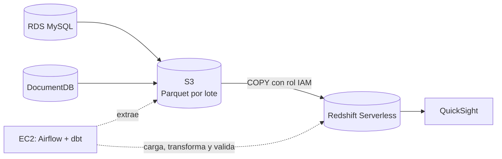

# Data warehouse de comercio electrónico en AWS

Migración a AWS del data warehouse local (DuckDB) del repositorio
[DE-DW](https://github.com/smm-0216/DE-DW/tree/main). Se conservan las reglas de
negocio, el modelo dimensional, la cuarentena y el SCD tipo 2.



Este README contiene todos los pasos para reproducir el trabajo, desde el
despliegue hasta la eliminación de los recursos. Se ejecutan en orden:

1. [Requisitos](#1-requisitos)
2. [Configuración](#2-configuración)
3. [Despliegue](#3-despliegue)
4. [Acceso a la instancia y a Airflow](#4-acceso-a-la-instancia-y-a-airflow)
5. [Carga inicial](#5-carga-inicial)
6. [Escenarios de validación](#6-escenarios-de-validación)
7. [Dashboard en QuickSight](#7-dashboard-en-quicksight)
8. [Nuevo lote hasta el dashboard](#8-nuevo-lote-hasta-el-dashboard)
9. [Eliminación de los recursos](#9-eliminación-de-los-recursos)

## 1. Requisitos

En el equipo local:

- Terraform 1.5 o superior.
- AWS CLI v2 con un perfil con permisos de administrador. En los ejemplos se llama `admin`:

  ```bash
  aws sts get-caller-identity --profile admin
  ```

La terminal de la instancia se abre desde la consola de AWS, así que no hace
falta instalar nada más. El
[Session Manager plugin](https://docs.aws.amazon.com/systems-manager/latest/userguide/session-manager-working-with-install-plugin.html)
solo se necesita para usar los túneles descritos en
[terraform/README.md](terraform/README.md#acceso).

La instancia clona el repositorio por HTTPS, así que este debe ser público y la
rama que se despliega debe estar en GitHub.

## 2. Configuración

```bash
git clone https://github.com/Dduquejh/Taller-DataWarehouse-DE-20262.git
cd Taller-DataWarehouse-DE-20262/terraform
cp terraform.tfvars.example terraform.tfvars
curl -s https://checkip.amazonaws.com     # IP pública del equipo
```

Edita `terraform.tfvars`, que git ignora y no contiene secretos:

| Variable | Valor | Obligatoria |
|---|---|---|
| `aws_profile` | Perfil de AWS CLI | Sí |
| `allowed_cidrs` | Tu IP, por ejemplo `["203.0.113.10/32"]`. Es lo único que abre el puerto 8080 de Airflow | Sí, para entrar a Airflow |
| `budget_email` | Correo para las alertas de costo, al 50 %, 80 % y 100 % del presupuesto | Recomendada |
| `repo_url`, `repo_branch` | Repositorio y rama que clona la instancia | Solo si usas un fork u otra rama |

## 3. Despliegue

```bash
terraform init
terraform plan      # debe crear recursos y no destruir ninguno
terraform apply     # 15 a 20 minutos
terraform output -raw airflow_url
```

El plan crea 53 recursos, o 54 con `budget_email`. Guarda la URL del último
comando.

**Costo:** los recursos empiezan a cobrar desde este paso. Una sesión de 8 horas
se estima entre USD 2 y 4, sin QuickSight, y hasta unos USD 7 si Redshift llega a
su límite diario. Al terminar, sigue el [paso 9](#9-eliminación-de-los-recursos).
El detalle está en [terraform/README.md](terraform/README.md#costo-estimado-us-east-2-on-demand-aproximado).

## 4. Acceso a la instancia y a Airflow

Al terminar el `apply`, la instancia tarda otros 5 a 10 minutos en instalar
Docker, clonar el repositorio y levantar Airflow.

1. En la consola de AWS, ve a **EC2 → Instancias → `ecommerce-dw-airflow` → Connect → Session Manager → Connect**.

2. Espera a que aparezca `== Arranque terminado` y sal con `Ctrl+C`:

   ```bash
   sudo su - ec2-user
   sudo tail -f /var/log/cloud-init-output.log
   ```

3. Comprueba los servicios y obtén la contraseña de Airflow:

   ```bash
   cd /opt/ecommerce-dw
   dwc ps                                          # postgres, webserver y scheduler activos
   sudo grep AIRFLOW_ADMIN_PASSWORD .airflow-secrets
   ```

4. Abre en el navegador la URL del paso 3 (`http://<IP pública>:8080`) y entra con el usuario `airflow`. Debe aparecer el DAG `ecommerce_pipeline`.

Todos los comandos de los pasos 5 a 8 se ejecutan en esta terminal, desde
`/opt/ecommerce-dw`, salvo los de Terraform del paso 7.

## 5. Carga inicial

```bash
scripts/generate_data.sh                 # crea tablas y colecciones y carga datos sintéticos
scripts/run_pipeline.sh --mode full      # primer lote: extracción completa
```

`run_pipeline.sh` dispara el DAG, espera a que termine y muestra el resultado.
También se puede seguir en la interfaz de Airflow.

Para comprobar el resultado:

```bash
scripts/warehouse.sh reconcile           # hechos frente a la fuente validada
scripts/warehouse.sh batches             # lotes y entidades cargadas
scripts/run_dbt.sh test                  # pruebas de dbt fuera del DAG (opcional)
```

**Resultado esperado:** ejecución `success` y hechos conciliados con la fuente.
Los resultados de las pruebas de dbt también se ven en el log de la tarea
`dbt_test`.

## 6. Escenarios de validación

### Registros defectuosos

```bash
scripts/warehouse.sh quarantine
```

**Resultado esperado:** rechazos con su motivo (`rejection_reason`) y su lote de
origen (`_batch_id`).

### Cambio en un atributo historizado (SCD tipo 2)

```bash
scripts/simulate_changes.sh
scripts/run_pipeline.sh
scripts/warehouse.sh scd2
```

**Resultado esperado:** para el cliente 1 y el producto 1, una versión nueva con
`is_current = true` y la anterior cerrada con `valid_to`.

### Nuevo lote incremental

```bash
scripts/verify_incremental_load.sh --batch-id 1
```

El script agrega un lote a las fuentes, lo procesa y luego repite y reprocesa.
Cada `--batch-id` solo se puede usar una vez.

**Resultado esperado:** cada hecho crece en 3 filas, y repetir o reprocesar no
cambia nada.

### Repetición de un lote exitoso

```bash
scripts/warehouse.sh batches                    # elige un batch_id
scripts/warehouse.sh state                      # guarda esta salida
scripts/run_pipeline.sh --reprocess <batch_id>
scripts/warehouse.sh state                      # compárala con la anterior
```

El reprocesamiento recarga el lote desde S3, sin consultar las fuentes.

**Resultado esperado:** la misma huella (`digest`) en los tres hechos y sin
versiones históricas nuevas.

### Fallo controlado y reejecución

1. En Airflow, ve a **Admin → Variables** y crea `ecommerce_dw_fail_stage` con el valor `load`. También acepta `extract` y `dbt`.

2. Ejecuta el pipeline. Debe fallar en `load_raw`, y `run_pipeline.sh` termina con error:

   ```bash
   scripts/run_pipeline.sh
   ```

3. Identifica el fallo:

   ```bash
   scripts/warehouse.sh runs      # batch_id, failed_tasks y estado failed
   ```

   El log de `load_raw` en Airflow muestra `[batch=<id>] fallo simulado`. `record_result` también queda en rojo, a propósito, porque el lote falló.

4. Borra la variable. En la ejecución fallida, selecciona `load_raw` y haz **Clear** con **Downstream** activado.

5. Cuando la ejecución termine en verde, comprueba el resultado:

   ```bash
   scripts/warehouse.sh runs
   scripts/warehouse.sh reconcile
   scripts/warehouse.sh state
   ```

**Resultado esperado:** el lote conserva su `batch_id`, no se vuelve a extraer y
se carga una sola vez, sin pérdida ni duplicados.

## 7. Dashboard en QuickSight

1. En la consola de AWS, suscribe la cuenta a QuickSight en la región `us-east-2`. La suscripción tiene costo mensual después de la prueba gratuita.

2. En el equipo local, cambia `enable_quicksight_vpc_connection` a `true` en `terraform.tfvars` y aplica:

   ```bash
   terraform apply
   terraform output -raw redshift_endpoint
   terraform output secret_value_commands      # ejecuta el comando "redshift" para ver el usuario y la contraseña
   ```

3. En QuickSight, crea un dataset de Redshift con conexión manual:

   | Campo | Valor |
   |---|---|
   | Conexión VPC | `ecommerce-dw-redshift` |
   | Servidor | Salida de `redshift_endpoint` |
   | Puerto | `5439` |
   | Base de datos | `ecommerce_dw` |
   | Usuario y contraseña | Salida del comando `redshift` |
   | Tabla | `marts.rpt_sales_dashboard` |

4. Crea el dashboard con estos elementos:
   - **Indicador** de ventas totales: `SUM(sales_amount)`.
   - **Gráfica** de ventas por `sale_date` o por `category`.
   - **Filtro** por `category`, `sales_channel` o `department`.

5. Valida el indicador en la terminal de la instancia, con el mismo filtro del dashboard:

   ```bash
   scripts/warehouse.sh query "
     select last_batch_id, refreshed_at, sum(sales_amount) as ventas_totales, count(*) as lineas
     from marts.rpt_sales_dashboard
     where category = 'Electrónica'
     group by last_batch_id, refreshed_at"
   ```

   Quita el `where` si el dashboard no tiene filtro. `ventas_totales` debe coincidir con el indicador, y `last_batch_id` y `refreshed_at` con los que muestra el dashboard.

**Actualización del dataset:** en Direct Query, el dashboard lee la vista en cada
consulta. En SPICE, agrega el ID del dataset a `quicksight_dataset_ids` en
`terraform.tfvars`, aplica y regenera el `.env` en la instancia:

```bash
sudo dw-render-env && dwc up -d
```

Desde ese momento, `record_result` actualiza el dataset al terminar cada lote
exitoso.

## 8. Nuevo lote hasta el dashboard

Toma nota del indicador actual y procesa un lote nuevo. Usa un `--batch-id` que no
hayas usado:

```bash
scripts/append_batch.sh --batch-id 2
scripts/run_pipeline.sh
```

**Resultado esperado:** el dashboard muestra el indicador actualizado y un
`last_batch_id` nuevo. Si usas SPICE, espera a que termine la actualización del
dataset.

## 9. Eliminación de los recursos

En el equipo local, desde `terraform/`:

```bash
terraform destroy
```

Este comando elimina la VPC, las bases de datos sin snapshot final, el bucket con
su contenido, los roles y la instancia. **Los datos no se pueden recuperar**, así
que guarda antes lo que necesites.

La suscripción de QuickSight pertenece a la cuenta y se cancela a mano en la
consola. Para pausar sin eliminar, consulta
[terraform/README.md](terraform/README.md#pausar-para-ahorrar).

## Referencia

### Comandos

| Objetivo | Comando |
|---|---|
| Lote incremental o automático | `scripts/run_pipeline.sh` |
| Carga completa | `scripts/run_pipeline.sh --mode full` |
| Reprocesar un lote desde S3 | `scripts/run_pipeline.sh --reprocess <batch_id>` |
| Disparar sin esperar el resultado | `scripts/run_pipeline.sh --no-wait` |
| Evidencias en Redshift | `scripts/warehouse.sh state \| reconcile \| batches \| runs \| quarantine \| scd2` |
| SCD2 de otro cliente o producto | `scripts/warehouse.sh scd2 --customer-id N --product-id N` |
| Consulta libre en Redshift | `scripts/warehouse.sh query "select ..."` |
| dbt fuera del DAG | `scripts/run_dbt.sh test` |
| Levantar o detener Airflow | `scripts/start_services.sh`, `scripts/stop_services.sh` |
| Logs y estado de los servicios | `dwc ps`, `dwc logs -f airflow-scheduler` |

Después de `generate_data.sh`, el siguiente lote debe ser `--mode full`.

### Solución de problemas

| Síntoma | Causa probable | Solución |
|---|---|---|
| Airflow no carga en el navegador | Cambió tu IP | Actualiza `allowed_cidrs` y ejecuta `terraform apply` |
| Airflow no carga recién terminado el `apply` | La instancia sigue arrancando | Espera a `== Arranque terminado` en el log del [paso 4](#4-acceso-a-la-instancia-y-a-airflow) |
| La URL de Airflow dejó de funcionar tras detener la instancia | La IP pública cambia al encenderla | Consúltala con `terraform output -raw airflow_url` |
| `Error: falta .env` | No se generó el archivo o el arranque no terminó | `sudo dw-render-env && dwc up -d` |
| Falla una tarea del DAG | Depende de la tarea | Abre su log en Airflow y busca `[batch=<id>]` |
| Redshift deja de aceptar conexiones | Se alcanzó el límite diario de cómputo, que desactiva el workgroup | Aumenta `redshift_daily_rpu_hours_limit` y aplica |

### Estructura

```
terraform/                    infraestructura (VPC, S3, RDS, DocumentDB, Redshift, EC2, IAM, QuickSight)
docker/                       imagen de Airflow + dbt-redshift y compose para EC2
src/airflow/dags/             DAG ecommerce_pipeline
src/ecommerce_dw/
  connections.py              RDS, DocumentDB, Redshift y S3 (Secrets Manager + TLS)
  ingestion/                  entidades, extracción a S3, COPY a Redshift, tareas del DAG
  transformations/            ejecución de dbt
  sources/                    generación de datos y cambios en las fuentes
  evidence.py                 consultas de evidencia
src/dbt/                      proyecto dbt adaptado a Redshift
scripts/                      operación en la instancia
```

### Seguridad

- No hay secretos en el repositorio: las contraseñas de las bases las genera y guarda Secrets Manager, y las de Airflow se generan en la instancia.
- Las bases y Redshift son privados, con TLS obligatorio. Los security groups solo admiten conexiones desde Airflow (y desde QuickSight hacia Redshift).
- La instancia usa su rol IAM por IMDSv2. Redshift lee S3 con un rol de solo lectura sobre `raw/`.
- El bucket tiene bloqueo de acceso público, cifrado, versionado y TLS obligatorio, y el pipeline no puede borrar en `raw/`.
- La interfaz de Airflow usa HTTP sin cifrar, por lo que el puerto 8080 solo se abre a las IP de `allowed_cidrs`.

### Más documentación

| Documento | Contenido |
|---|---|
| [terraform/README.md](terraform/README.md) | Infraestructura: diagrama de red, permisos, túneles, costos y pausa |
| [docs/aws/pipeline.md](docs/aws/pipeline.md) | Lotes, marcas de agua, estados, decisiones y diferencias frente a la versión local |
| [docs/data_model.md](docs/data_model.md) | Modelo estrella, SCD2 y llaves |
| [docs/architecture.md](docs/architecture.md), [docs/etapas/](docs/etapas/) | Guía original de la versión local con DuckDB, como referencia |
