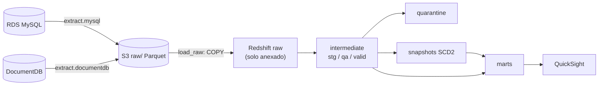

# Pipeline en AWS

Este documento explica cómo funciona el pipeline migrado: lotes, marcas de
agua, estados, idempotencia, recuperación y las diferencias frente a la
versión local con DuckDB. La infraestructura está en
[terraform/README.md](../../terraform/README.md).

## Flujo



El DAG `ecommerce_pipeline` ejecuta, en orden y sin pasos manuales:

| # | Tarea | Qué hace |
|---|---|---|
| 1 | `validate_and_prepare` | Valida parámetros y variables. Prueba S3, Redshift, MySQL y DocumentDB. Crea los esquemas y las tablas de control y `raw` si no existen. Calcula el `batch_id` y el plan por entidad (modo y marca de agua) |
| 2-3 | `extract.mysql`, `extract.documentdb` | Extraen en paralelo y escriben Parquet y un manifiesto en S3 |
| 4 | `load_raw` | Ejecuta `COPY` de todas las entidades del lote en una sola transacción y verifica los conteos contra el manifiesto |
| 5 | `dbt_deps` … `dbt_run_marts` | Ejecutan seeds, staging y calidad, cuarentena, snapshots SCD2 y marts en Redshift |
| 6 | `dbt_test` | Ejecuta pruebas de unicidad, nulos, relaciones, reglas de negocio y conciliación |
| 7 | `record_result` | Siempre se ejecuta. Escribe `control.pipeline_runs` y `s3://…/control/runs/`, marca el lote como `processed` y, opcionalmente, refresca SPICE |

Todas las tareas tienen 2 reintentos con espera exponencial (30 s a 5 min).
`max_active_runs=1` evita lotes concurrentes. Cada línea de log lleva
`[batch=<id>]`.

## Lotes

### Identificación

- **`batch_id`**: es el instante lógico de la ejecución en UTC (`20261103T110000Z`). Se mantiene igual en reintentos y al limpiar tareas, y se puede ordenar como texto.
- **En S3**: `raw/<fuente>/<entidad>/batch_id=<id>/data.parquet` y `_manifest.json`. El manifiesto guarda el lote, el modo, la fecha de extracción, las marcas de agua, la cantidad de filas, el SHA-256 y la URI. Los mismos datos van en los metadatos del Parquet, así que si se pierde el manifiesto se reconstruye desde el archivo.
- **En Redshift**: cada fila de `raw` lleva `_batch_id`, `_source` y `_extracted_at`. `control.batch_entities` tiene una fila por lote y entidad.

### Formato: Parquet

Se usa Parquet porque `COPY … FORMAT AS PARQUET` conserva los tipos
(decimales, fechas, booleanos) sin depender de separadores ni comillas, y
porque las reseñas traen texto libre y JSON. El archivo tiene exactamente las
columnas de la tabla `raw` y en el mismo orden, porque `COPY` de Parquet las
asocia por posición.

### Sin sobrescritura

- Las escrituras usan `If-None-Match: *`: si la llave ya existe, S3 rechaza la escritura.
- El rol de la instancia no tiene `s3:DeleteObject` sobre `raw/`, y el bucket tiene versionado.
- Si un reintento encuentra el lote ya escrito, lo reutiliza y no vuelve a consultar la fuente.

### Estados y marca de avance

| Estado | Dónde | Cuándo cambia |
|---|---|---|
| extraído | S3 (manifiesto) | Al escribir el Parquet y el manifiesto |
| `loaded` | `control.batch_entities` | En el mismo `COMMIT` del `COPY`. **Desde aquí avanza la marca de agua** |
| `processed` | `control.batch_entities` | Lo marca `record_result` cuando dbt (modelos, snapshots y pruebas) terminó bien |
| resultado de la ejecución | `control.pipeline_runs` | `record_result`, con `success` o `failed` y las tareas fallidas |

La marca de agua avanza con `loaded` y no con `processed`. Los datos ya están
seguros en `raw`, así que si dbt falla se reejecuta sobre ellos sin volver a
extraer y sin perder filas.

### Extracción completa e incremental

| Entidad | Columna de avance | Condición incremental |
|---|---|---|
| `customers`, `products` | `updated_at` | `updated_at > marca` |
| `orders`, `order_items` | `order_id`, `order_item_id` | `id > marca` (inmutables) |
| `reviews`, `navigation_events` | `review_id`, `event_id` | `id > marca` (inmutables) |

- La marca es el máximo de `watermark_to` de los lotes `loaded` o `processed` desde la última carga `full` de la entidad.
- `mode=auto` hace una carga `full` si la entidad nunca la tuvo, y si no, una `incremental`.
- MySQL se extrae dentro de `START TRANSACTION WITH CONSISTENT SNAPSHOT`, así que pedidos y líneas salen del mismo instante.

### `raw` de solo anexado y staging

`raw` acumula los lotes. Los modelos `stg_*` usan la macro
`latest_batch_rows`, que hace lo siguiente:

1. Descarta lo anterior a la última carga `full` de la entidad. Una carga completa redefine el estado de la fuente, por ejemplo después de `generate_data.sh`.
2. Se queda con la versión del lote más reciente de cada llave.
3. Considera solo los lotes con `COPY` confirmado.

Por eso `stg_*` sigue cumpliendo `unique` sobre la llave, y una fila que
llegó a `raw` en un lote anterior se vuelve a evaluar en cada ejecución. Una
línea rechazada por pedido huérfano pasa a ser válida cuando llega su pedido.

## Calidad y cuarentena

Las reglas son las mismas que en la versión local (ver
[architecture.md](../architecture.md#calidad-de-datos-y-cuarentena)). Cada
tabla `quarantine.*` conserva `rejection_reason`, `_batch_id` y
`_extracted_at`, y con eso se llega al archivo en S3 y a
`control.batch_entities`.

```bash
scripts/warehouse.sh quarantine
```

## Escenarios de evidencia

Se ejecutan en la instancia, desde `/opt/ecommerce-dw`.

| Escenario | Cómo se demuestra | Resultado esperado |
|---|---|---|
| Carga inicial | `scripts/generate_data.sh && scripts/run_pipeline.sh --mode full`; luego `scripts/warehouse.sh reconcile` | Marts poblados y hechos conciliados con la fuente validada |
| Registros defectuosos | `scripts/warehouse.sh quarantine` | Rechazos con motivo y lote |
| Repetición de un lote exitoso | `scripts/run_pipeline.sh --reprocess <batch_id>` y `scripts/warehouse.sh state` antes y después | Misma huella (`digest`) en los tres hechos y snapshots sin versiones nuevas |
| Nuevo lote incremental | `scripts/verify_incremental_load.sh --batch-id N` | Cada hecho crece en 3 filas, y repetir o reprocesar no cambia nada |
| Cambio SCD2 | `scripts/simulate_changes.sh && scripts/run_pipeline.sh`; luego `scripts/warehouse.sh scd2` | Nueva versión con `is_current = true` y la anterior con `valid_to` |
| Fallo controlado | Ver la sección siguiente | Recuperación sin pérdida ni duplicados |

### Fallo controlado y reejecución

1. En Airflow, en **Admin → Variables**, crear `ecommerce_dw_fail_stage` con el valor `load`. También acepta `extract` y `dbt`.
2. Ejecutar `scripts/run_pipeline.sh`. `load_raw` copia la primera entidad y falla antes del `COMMIT`. La transacción se revierte, así que `raw` y `control` quedan como estaban. `record_result` registra `failed` en `control.pipeline_runs`.
3. Identificar el fallo:
   - `scripts/warehouse.sh runs` muestra el `batch_id`, `failed_tasks` y el estado.
   - Los logs de la tarea muestran `[batch=…] fallo simulado`.
4. Borrar la variable y, en la ejecución fallida, hacer **Clear** sobre `load_raw` con *Downstream* activado. El lote conserva su `batch_id`: no se vuelve a extraer, porque los archivos ya están en S3, se carga una sola vez y termina `processed`.
5. `scripts/warehouse.sh reconcile` y `state` muestran que no hubo pérdida ni duplicados.

## QuickSight

El dashboard consume la vista `marts.rpt_sales_dashboard`: una fila por
línea de venta con fecha, categoría, canal y geografía, más `last_batch_id` y
`refreshed_at`.

Elementos mínimos del dashboard:

- **KPI** "Ventas totales" = `SUM(sales_amount)`.
- **Gráfica** de ventas por `sale_date` (agregada por mes) o por `category`.
- **Filtro** por `category`, `sales_channel` o `department`.

Consulta para validar el indicador, con los mismos filtros que el dashboard:

```sql
select
    last_batch_id,
    refreshed_at,
    sum(sales_amount) as ventas_totales,
    count(*) as lineas
from marts.rpt_sales_dashboard
where category = 'Electrónica'        -- mismo filtro que el dashboard (quitar si no hay filtro)
group by last_batch_id, refreshed_at;
```

`last_batch_id` y `refreshed_at` deben coincidir con los que muestra el
dashboard (por ejemplo, en una tabla o en la descripción). Así se comprueba
que ambos valores salen de la misma actualización.

**SPICE**: si el dataset usa SPICE, se pone su ID en `quicksight_dataset_ids`
(Terraform) y `record_result` llama a `CreateIngestion` al terminar cada lote
exitoso. Sin SPICE (Direct Query), el dashboard lee la vista en cada consulta.

## Diferencias frente a la versión local

| Aspecto | Local | AWS |
|---|---|---|
| Fuentes | MySQL 8.4 y MongoDB 8 en Docker | RDS MySQL 8.4 y DocumentDB 5.0, privados, con TLS obligatorio |
| Credenciales | `.env` | Secrets Manager (contraseñas gestionadas), rol IAM de la instancia |
| Extracción | CSV por corrida, siempre completa | Parquet por lote en S3, completa o incremental por marca de agua |
| `raw` | Se reemplazaba en cada corrida | Solo anexado con `_batch_id`; staging toma la última versión |
| Warehouse | DuckDB (un solo escritor, lock de archivo) | Redshift Serverless; dbt con 4 hilos, sin lock |
| Carga | `INSERT … FROM read_csv` | `COPY … FORMAT AS PARQUET` con rol IAM |
| DAGs | Maestro + `extract_to_raw` + `transform_warehouse` | Un solo DAG con validación, reprocesamiento y registro del resultado |
| Snapshots | Esquema `intermediate` | Esquema `snapshots` |

### Ajustes de SQL para Redshift

| DuckDB | Redshift |
|---|---|
| `select * exclude (col)` | `dbt_utils.star(except=[...])` |
| `timezone('America/Bogota', ts)` | macro `to_business_time` → `convert_timezone('UTC', 'America/Bogota', ts)` |
| `a is distinct from b` | macro `is_distinct_from` |
| `extract(isodow from d)` | macro `iso_day_of_week` (a partir de `dow`) |
| `json_extract_string(doc, '$.a.b')` | `json_extract_path_text(doc, 'a', 'b', true)` |
| `datediff('day', a, b)`, `fecha - n` | `dbt.datediff`, `dbt.dateadd` |
| `TIMESTAMPTZ` en raw | `TIMESTAMP` en UTC; la conversión se hace en los hechos |
| Esquema `raw` | `RAW` es palabra reservada: va entre comillas (`"raw".tabla`) |
| Vistas | `bind: false` (late binding), para que reconstruir una vista no borre en cascada a las dependientes |

### MongoDB frente a DocumentDB

- **Retryable writes**: DocumentDB no los admite, así que se usa `retryWrites=False`.
- **Conexión**: TLS obligatorio con `global-bundle.pem`, `replicaSet=rs0` y `authSource=admin`.
- **Validador `$jsonSchema`**: DocumentDB 5.0 lo admite, pero no todas las palabras clave. Si el servidor lo rechaza, la colección se crea sin validador, se registra una advertencia y la calidad se sigue controlando en dbt.
- **`bypassDocumentValidation`**: si no está disponible, los registros defectuosos se insertan sin la opción.
- **Acceso desde el equipo local**: Compass no llega directo al clúster, porque es privado. Se usa el túnel de Session Manager con `tlsAllowInvalidHostnames=true`.
