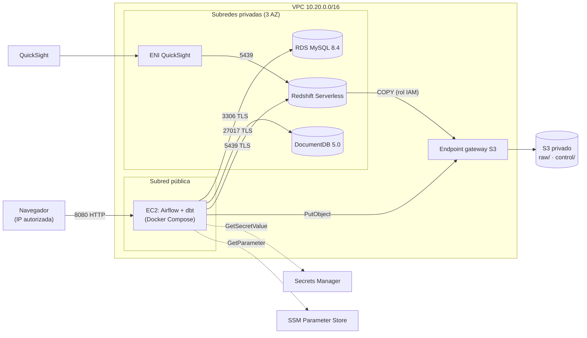

# Infraestructura AWS del data warehouse

Un solo stack de Terraform crea todo el ambiente. Un `apply` lo levanta y un
`destroy` lo elimina, sin pasos intermedios entre stacks.

Este documento describe la infraestructura. Los pasos para desplegarla, ejecutar
el pipeline y eliminarla están en el [README principal](../README.md).



## Archivos

| Archivo | Qué crea |
|---|---|
| `network.tf` | VPC, 1 subred pública, 3 privadas, IGW, endpoint gateway de S3 y los 5 security groups con su matriz de conexiones |
| `storage.tf` | Bucket privado: versionado, SSE-S3, bloqueo de acceso público, política que exige TLS y ciclo de vida de versiones antiguas |
| `sources.tf` | RDS MySQL y DocumentDB privados, cifrados, con TLS obligatorio y contraseña gestionada por Secrets Manager |
| `redshift.tf` | Namespace y workgroup de Redshift Serverless privado, con enhanced VPC routing, SSL obligatorio y límite diario de horas-RPU |
| `iam.tf` | Rol de EC2 (S3, secretos, Redshift, SPICE y SSM), rol de COPY para Redshift y rol de la conexión VPC de QuickSight |
| `ec2.tf` | Parámetro SSM con la configuración del pipeline e instancia con IMDSv2 |
| `user_data.sh.tftpl` | Arranque: Docker, clonado del repo, certificado TLS de AWS, `.env` y `docker compose up` |
| `quicksight.tf` | Conexión VPC de QuickSight hacia Redshift (opcional) |
| `budget.tf` | Presupuesto mensual con alertas por correo (opcional) |

El plan crea 53 recursos. El presupuesto agrega 1, si se define `budget_email`, y
la conexión de QuickSight agrega 3, con `enable_quicksight_vpc_connection = true`.

## Conexiones permitidas

| Origen | Destino | Puerto | Cómo se autoriza |
|---|---|---|---|
| IP autorizada | Airflow (EC2) | 8080 | Regla de entrada limitada a `allowed_cidrs` |
| EC2 Instance Connect | EC2 | 22 | Lista de prefijos administrada de ese servicio de AWS |
| Airflow (EC2) | RDS MySQL | 3306 | SG `mysql` ← SG `airflow`; usuario y contraseña desde Secrets Manager; TLS obligatorio |
| Airflow (EC2) | DocumentDB | 27017 | SG `docdb` ← SG `airflow`; Secrets Manager; TLS obligatorio |
| Airflow (EC2) / dbt | Redshift | 5439 | SG `redshift` ← SG `airflow`; Secrets Manager o `GetCredentials`; `require_ssl` |
| Airflow (EC2) | S3 `raw/`, `control/` | 443 | Rol `airflow-ec2`; sin `DeleteObject` en `raw/` |
| Redshift | S3 `raw/` | 443 | Rol `redshift-s3` (solo lectura); tráfico por el endpoint gateway |
| QuickSight | Redshift | 5439 | Conexión VPC: SG `quicksight` ↔ SG `redshift` |

Ninguna base de datos es pública ni tiene ruta a internet. No existen llaves
de acceso: la instancia usa su rol por IMDSv2 y las contraseñas viven en
Secrets Manager. El `.env` de la instancia contiene solo endpoints y ARNs,
más las claves propias de Airflow generadas en la misma instancia.

## Acceso

El camino principal no requiere instalar nada en el equipo local:

| Para | Cómo |
|---|---|
| Terminal en la instancia | Consola de AWS: **EC2 → Instancias → `ecommerce-dw-airflow` → Connect → Session Manager** |
| Interfaz de Airflow | `terraform output -raw airflow_url`, con `http://`, desde una IP de `allowed_cidrs` |
| Contraseña de Airflow (usuario `airflow`) | En la instancia: `sudo grep AIRFLOW_ADMIN_PASSWORD /opt/ecommerce-dw/.airflow-secrets` |
| Consultas en Redshift | `scripts/warehouse.sh query "select ..."` en la instancia, o Query Editor v2 en la consola |
| Credenciales de una base | `terraform output secret_value_commands` |

### Túneles (opcional)

Con el
[Session Manager plugin](https://docs.aws.amazon.com/systems-manager/latest/userguide/session-manager-working-with-install-plugin.html)
instalado, se puede entrar desde el equipo local a la instancia y a los servicios
privados. Estos comandos se ejecutan desde `terraform/`:

| Para | Comando |
|---|---|
| Terminal en la instancia | `eval "$(terraform output -raw ssm_session)"` |
| UI de Airflow → `localhost:8080` | `eval "$(terraform output -raw ssm_tunnel_airflow)"` |
| DBeaver → MySQL en `localhost:3307` | `eval "$(terraform output -raw ssm_tunnel_mysql)"` |
| Compass → DocumentDB en `localhost:27018` | `eval "$(terraform output -raw ssm_tunnel_docdb)"` |
| DBeaver → Redshift en `localhost:5439` | `eval "$(terraform output -raw ssm_tunnel_redshift)"` |

Por el túnel, DocumentDB necesita `tls=true&tlsCAFile=global-bundle.pem&tlsAllowInvalidHostnames=true&directConnection=true`,
porque el certificado está emitido para el endpoint y no para `localhost`.

### Cambio de un endpoint

Si cambia un endpoint (p. ej. al recrear una base), dentro de la instancia:

```bash
sudo dw-render-env && dwc up -d
```

### Cambios en el arranque

La instancia ignora los cambios de `user_data` para no recrearse sin aviso. Para
aplicar un cambio en `user_data.sh.tftpl`, hay que recrearla:

```bash
terraform apply -replace=aws_instance.airflow
```

## Pausar para ahorrar

| Recurso | Pausar | Reanudar |
|---|---|---|
| EC2 | `aws ec2 stop-instances --instance-ids <id>` | `start-instances` |
| RDS | `aws rds stop-db-instance --db-instance-identifier ecommerce-dw-mysql` | `start-db-instance` (AWS lo reinicia solo a los 7 días) |
| DocumentDB | `aws docdb stop-db-cluster --db-cluster-identifier ecommerce-dw-docdb` | `start-db-cluster` (igual, 7 días) |
| Redshift Serverless | Se cobra solo mientras ejecuta consultas | — |

La IP pública de la instancia cambia al encenderla de nuevo.

## Costo estimado (us-east-2, on-demand, aproximado)

| Recurso | Precio | 8 h de trabajo | Encendido 24/7 un mes |
|---|---|---|---|
| EC2 `t3.medium` + IPv4 + gp3 30 GiB | ~USD 0,047/h + 2,4/mes | ~0,40 | ~36 |
| RDS `db.t4g.micro` + 20 GiB gp3 | ~USD 0,016/h + 2,3/mes | ~0,15 | ~14 |
| DocumentDB `db.t4g.medium` + almacenamiento e I/O | ~USD 0,08/h | ~0,65 | ~60 |
| Redshift Serverless 8 RPU | ~USD 0,375/RPU-h, por segundo y solo en uso | ~1-3 (según consultas) | Depende del uso; tope diario de 16 RPU-h ≈ USD 6/día |
| Secrets Manager (3 secretos) | USD 0,40/secreto-mes | ~0,01 | 1,2 |
| S3, endpoint gateway, SSM | Céntimos | ~0 | <1 |
| QuickSight (Author) | ~USD 24/mes; 30 días de prueba | — | 24 |

DocumentDB es el recurso fijo más caro, así que conviene detenerlo (o
destruir el stack) al terminar cada sesión. Hay que confirmar los precios
con la [calculadora de AWS](https://calculator.aws/) antes de la entrega.
